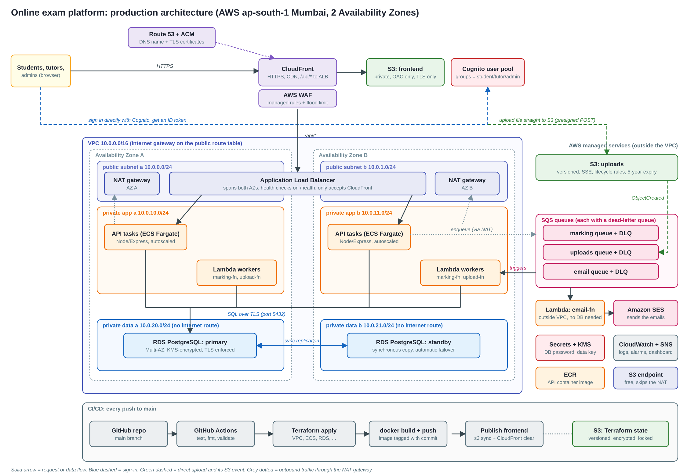
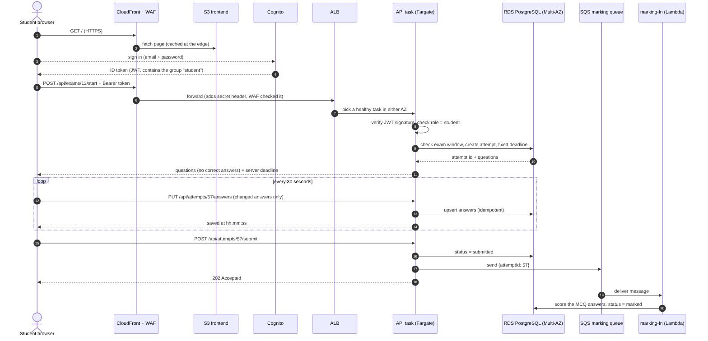
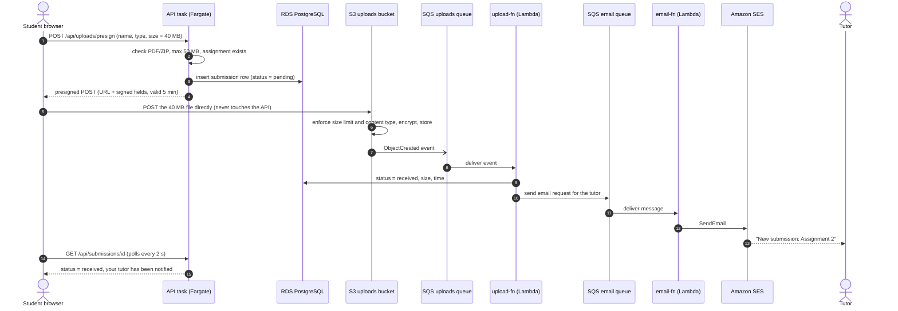
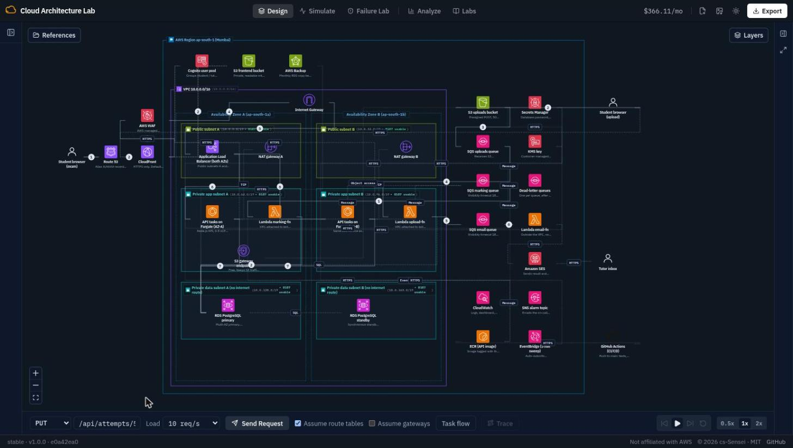
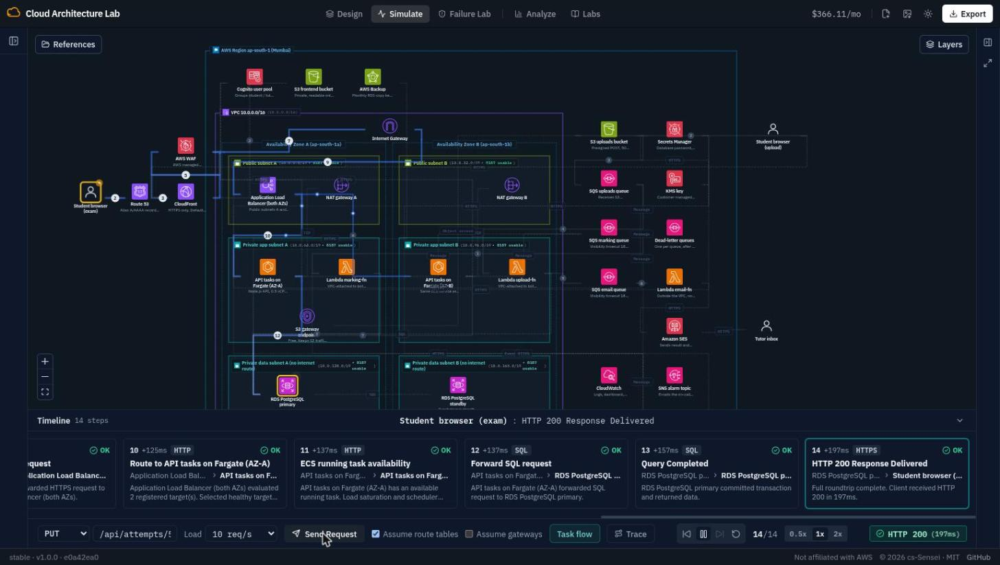
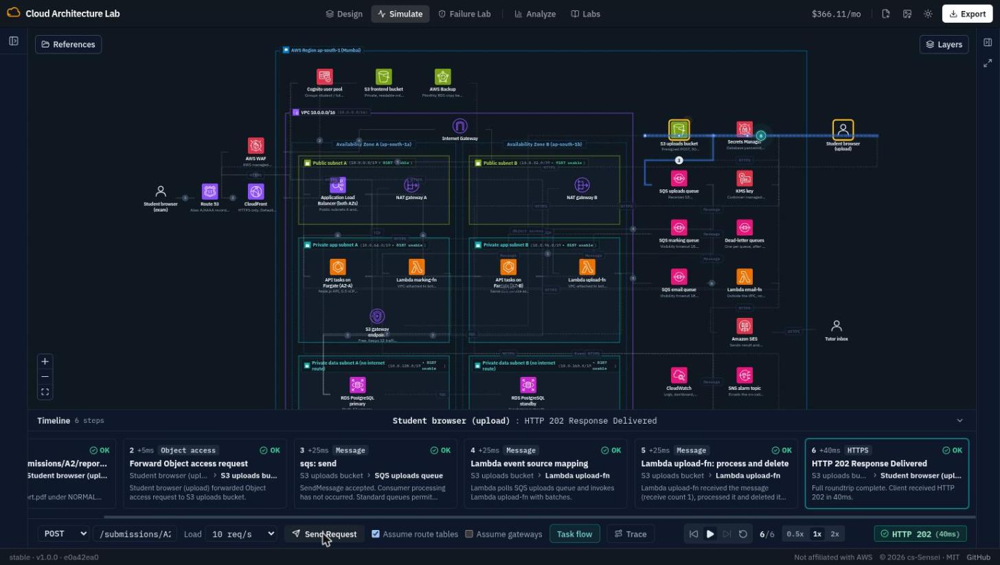
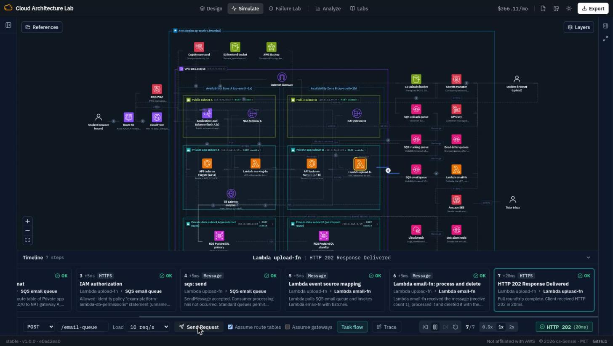
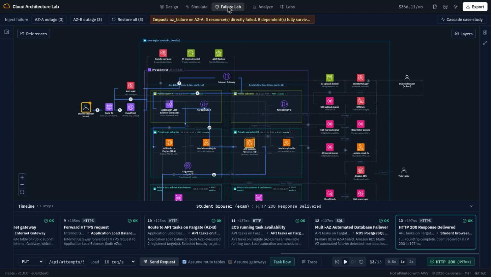
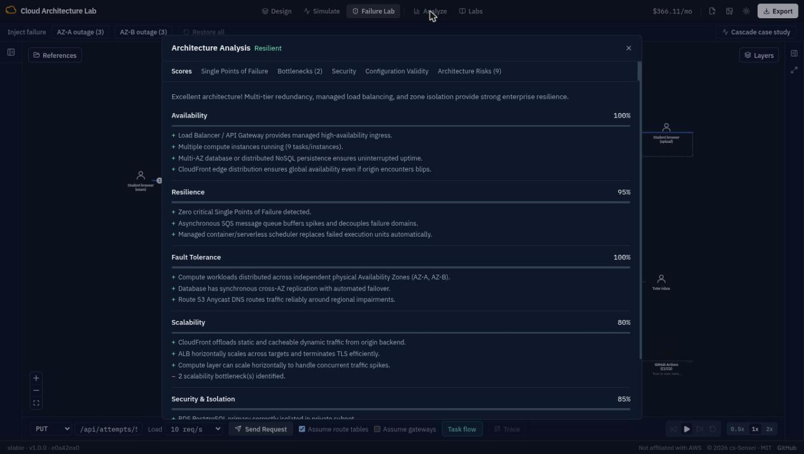

# Architecture

## Task 1: production architecture

Source: `architecture.svg` (generated by `build_diagram.py`).

Everything runs in ap-south-1 (Mumbai), the closest AWS region to Bhutan. How to read it: traffic enters at CloudFront (with WAF in front). Static files come from S3. Anything under `/api/*` goes to the Application Load Balancer, which spreads it over API containers in two Availability Zones. The API talks to a Multi-AZ PostgreSQL database in the data subnets, which have no route to the internet. Slow work (marking, emails) goes through SQS to Lambda. Files go straight from the browser to S3.

| Tier | Subnet | AZ A | AZ B |
|---|---|---|---|
| Edge | none (global) | CloudFront, WAF | |
| Public | `10.0.0.0/24`, `10.0.1.0/24` | NAT gateway, ALB node | NAT gateway, ALB node |
| App | `10.0.10.0/24`, `10.0.11.0/24` | Fargate tasks, Lambda network interfaces | Fargate tasks, Lambda network interfaces |
| Data | `10.0.20.0/24`, `10.0.21.0/24` | RDS primary (or standby) | RDS standby (or primary) |

## Walkthrough 1: a student opens an exam and answers autosave

Points to notice:
- The deadline is set by the server when the exam starts. The browser timer only displays it.
- Questions are sent without the correct answers. Marking happens on the server side only.
- Autosave sends only changed answers and is idempotent (same request twice = same result), so retrying after a network blip is safe.
- Submit returns immediately. The marking happens afterwards, from the queue.

## Walkthrough 2: a student uploads a 40 MB assignment and the tutor is notified

Points to notice:
- The API never carries the 40 MB. It only hands out a short-lived signed form. S3 itself rejects anything over 50 MB or of the wrong type.
- The tutor email is sent after S3 confirms the file exists (via the S3 event), not when the student clicks upload.
- If the email fails 3 times the message goes to a dead-letter queue and an alarm fires. The submission is still saved.

## Exam peak and loss of one AZ (under 300 words)

**Exam peak.** 3,000 students starting within 5 minutes is about 10 start requests a second. After that, autosave from 3,000 students every 30 seconds is about 100 small writes a second. Before each exam window, scheduled scaling raises the API from 2 to 6 Fargate tasks (3 per AZ), so the capacity is there before students arrive. Target tracking can then go up to 12 at about 50 requests a second per task. CloudFront serves the page and scripts from cache, so only /api/* reaches the ALB. Uploads go from the browser straight to S3, so 50 MB files never use API capacity. Marking runs through SQS with Lambda concurrency capped at 5, so a burst of submissions queues instead of overloading the database. Each task holds at most 5 database connections.

**Loss of one AZ.** Every tier exists in both AZs. If AZ A fails, ALB health checks (every 10 seconds, two failures) stop sending traffic to its tasks within about 20 seconds. The 3 tasks in AZ B carry the load, because the pre-scaled floor is sized so one AZ can serve the peak, and ECS starts replacements there. RDS Multi-AZ promotes the standby in AZ B, usually within 1 to 2 minutes, behind the same endpoint. Replication is synchronous, so no committed answer is lost (RPO close to 0, and point-in-time restore covers the 5-minute worst case). Each AZ has its own NAT gateway, so the surviving AZ keeps its outbound access. SQS, S3, Cognito and SES run across several AZs, and CloudFront is global, so they are not affected. Students may see brief errors, but the browser keeps answers locally and retries the autosave. The outage is a couple of minutes, inside the 1-hour RTO and the 99.9% target (about 43 minutes a month).

## Targets and how each is met

| Target | How |
|---|---|
| 99.9% during exams (about 43 min/month) | Two AZs at every tier, ALB health checks, pre-scaled tasks, Multi-AZ database, managed regional services |
| Survive loss of one AZ | See above. Simulated in the Cloud Architecture Lab (AZ-A outage, still HTTP 200), and `scripts/simulate-az-failure.sh` does the same on a real deployment |
| RPO 5 minutes | Multi-AZ replication is synchronous (about 0 for an AZ loss). Point-in-time restore uses transaction logs shipped about every 5 minutes. Browser also keeps unsaved answers locally. |
| RTO 1 hour | AZ loss: about 2 minutes, automatic. Database corruption or region problem: restore from backup into a new instance, then `terraform apply` (the whole stack is code). |
| Records 5 years | S3 lifecycle (IA at 30 days, Glacier at 365, expire at 1,826 days); optional AWS Backup monthly copy kept 5 years |
| Encryption in transit | Browser to CloudFront is HTTPS only (HTTP redirects). With the custom domain, CloudFront to the ALB is HTTPS too (ACM certificate on `origin.<domain>`, TLS 1.2 and 1.3 only). TLS ends at the ALB; the last hop to the tasks stays inside the private subnet. Buckets deny any non-TLS request, RDS has `rds.force_ssl=1` and the API and workers check the RDS certificate. Cognito, S3 and SES are only reachable over HTTPS. |
| Encryption at rest | RDS and secret with a KMS key, S3 with SSE-S3, SQS with SQS-managed keys |

## Task 3: Cloud Architecture Lab

The same design is built in the Cloud Architecture Lab simulator. The draft files and the step-by-step instructions are in [`cloud-architecture-lab/`](cloud-architecture-lab/README.md).

| Test | Result in the simulator |
|---|---|
| Walkthrough 1 (autosave, `PUT /api/attempts/57/answers`) | HTTP 200 in 14 steps: Route 53, CloudFront, WAF, IGW, ALB, API task, RDS |
| Walkthrough 2 part A (40 MB upload to S3, event to queue) | HTTP 202 |
| Walkthrough 2 part B (upload worker to email queue to email worker) | HTTP 202 |
| AZ-A outage, then walkthrough 1 again | HTTP 200 through the AZ-B tasks, RDS fails over to the standby |
| Analyze | "Resilient": availability 100, resilience 95, fault tolerance 100, no single points of failure |

### Screenshots from the simulator

**Design:**

**Walkthrough 1, HTTP 200:**

**Walkthrough 2 part A, HTTP 202:**

**Walkthrough 2 part B, HTTP 202:**

**AZ-A outage, still HTTP 200 (step 12 is the database failover):**

**Analyze scores:**

