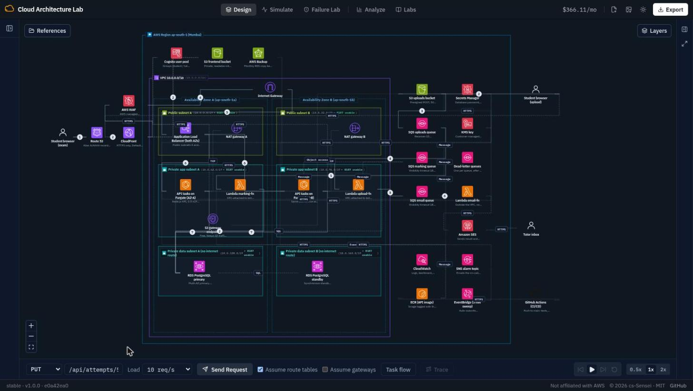
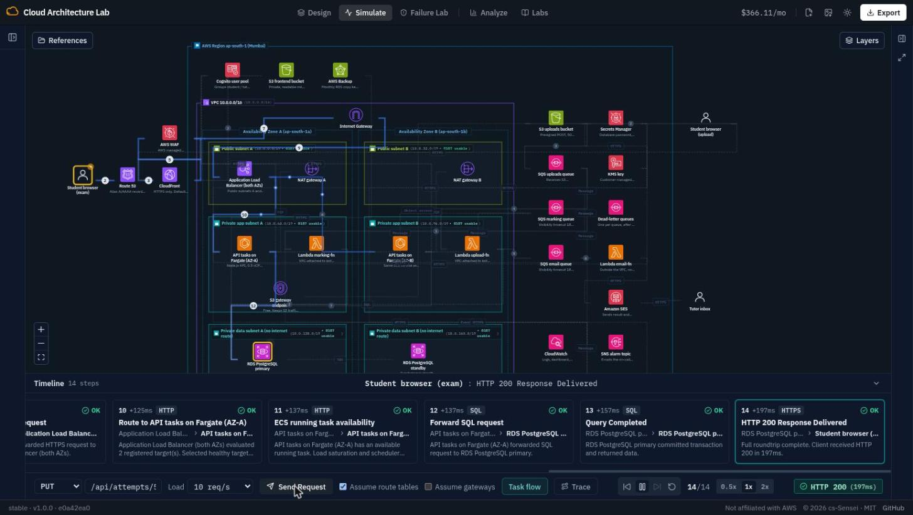
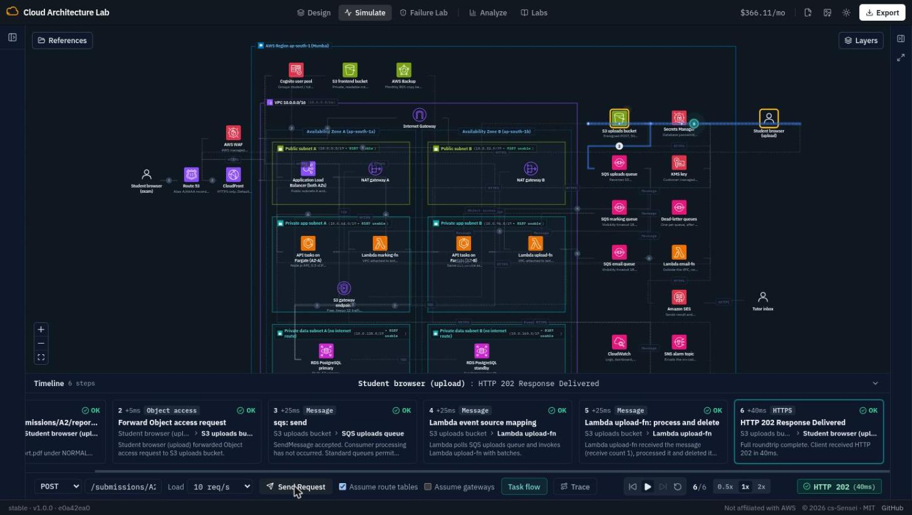
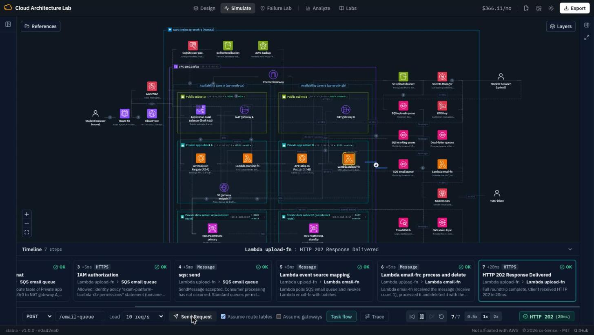
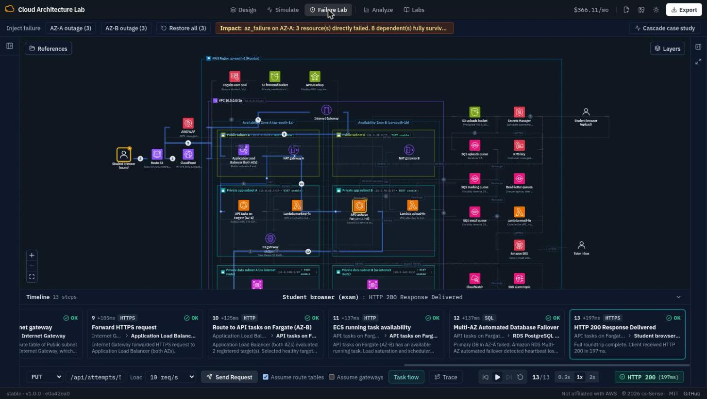
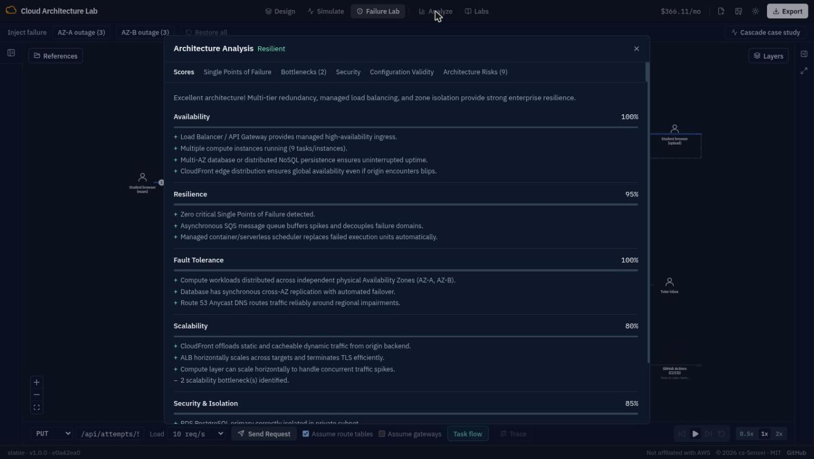
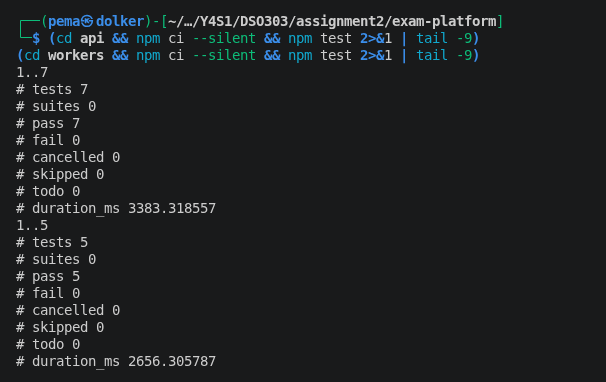
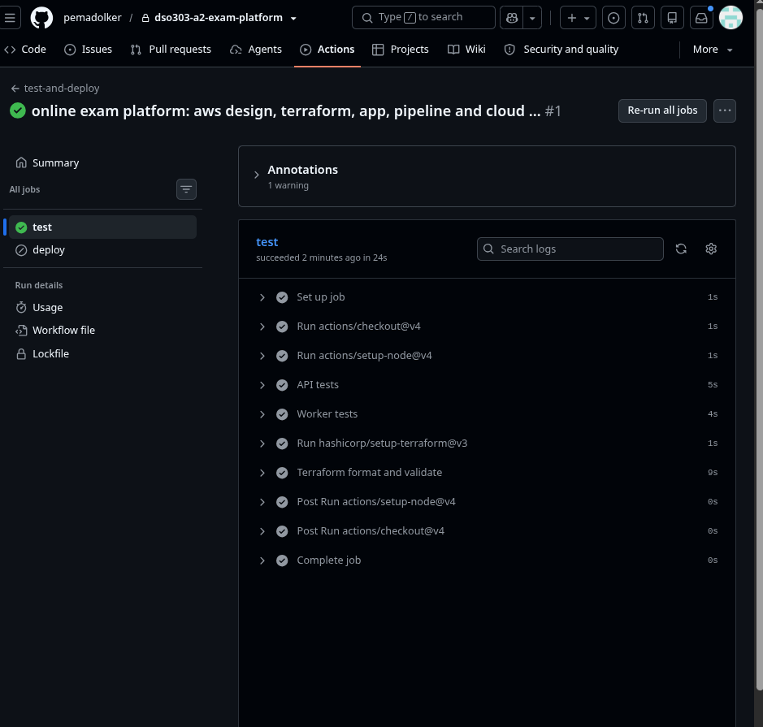

# Evidence

Screenshots for the parts that can't be seen from the code alone. How to produce each simulator one is in `architecture/cloud-architecture-lab/README.md`.

## Cloud Architecture Lab (Task 3)

| File | What it shows |
|---|---|
| `cloud-architecture-lab.png` | The full design built in the Cloud Architecture Lab, Design view |
| `lab-walkthrough-1.png` | Walkthrough 1 (autosave) finished with HTTP 200 |
| `lab-walkthrough-2a.png` | Walkthrough 2 part A (40 MB upload to S3, event to the queue) finished with HTTP 202 |
| `lab-walkthrough-2b.png` | Walkthrough 2 part B (upload worker to email queue to email worker) finished with HTTP 202 |
| `lab-az-failure.png` | AZ-A outage active (impact banner: 3 resources failed, 8 dependents survived), the request still returns HTTP 200 through the AZ-B tasks, and step 12 is the RDS Multi-AZ failover |
| `lab-analyze.png` | Analyze scores: Resilient, no single points of failure |

## Code and pipeline

| File | What it shows |
|---|---|
| `tests-passing.png` | `npm test` passing in `api/` and `workers/` |
| `github-actions-test.png` | A green `test` job on GitHub after a push to `main` (tests, `terraform fmt` and `terraform validate`) |

## Screenshots

